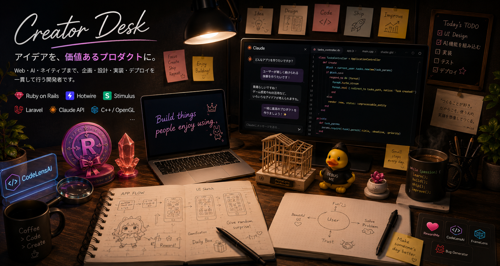

  

# Hi, I'm Mize!

Web・AI・ネイティブアプリケーションを個人開発しています。

Ruby on Railsを中心に、
Laravel、Claude API、C++/OpenGLまで、
企画・設計・実装・デプロイまで一貫して取り組んでいます。

---

## About Me

- 🎓 RUNTEQ 79期
- 🚀 Web・AI・C++アプリを企画・設計・開発・リリース
- 🤖 Claude APIを活用したAIアプリを開発
- 🎮 ゲームUXとAI UXの設計が好き
- 🛠 UI/UXからバックエンドまで一貫して開発

---

## Tech Stack

---

## Featured Projects

### 💖 RewardMe
タスクをこなしてEXPを獲得し、リボンちゃんを育成できるゲーム感覚のタスク管理アプリ。

**Rails · Hotwire · PostgreSQL · Docker · Render**

🔗 [Demo](https://rewardme-qaq3.onrender.com) | 📖 [GitHub](https://github.com/mize1978/rewardme) | 📝 [Zenn](https://zenn.dev/mizel1978/articles/a10a4368b282d3)

  

---

### 🤖 CodeLensAI
コードリポジトリをAIがレビューし、品質スコアを可視化するWebアプリ。

**Rails · Claude API · Hotwire · PostgreSQL · Render**

🔗 [Demo](https://codelens-ai-vplg.onrender.com) | 📖 [GitHub](https://github.com/mize1978/codelens-ai)

---

### 🏗️ FrameLens
C++/OpenGLで実装した3Dフレームワーク解析ツール。設計・アルゴリズム・低レイヤー実装力を見せる作品。

**C++ · OpenGL · CMake · AddressSanitizer**

📖 [GitHub](https://github.com/mize1978/FrameLens)

---

### 🦆 DebugMe
ラバーダックデバッグにインスピレーションを受けた、AI搭載の思考整理ツール。AIは裏方。答えを出すのはあなた自身。

**Rails · Claude API · SSE · Hotwire · Render**

📖 [GitHub](https://github.com/mize1978/errorlog-ai)

---

## Contact

[X (@mizelategm66172)](https://x.com/mizelategm66172)

---

## GitHub Stats

  

  

