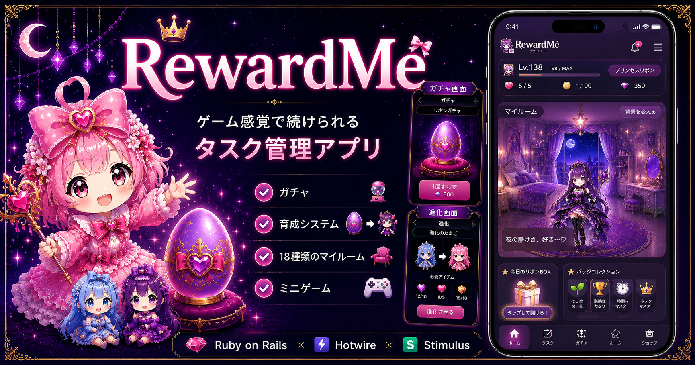
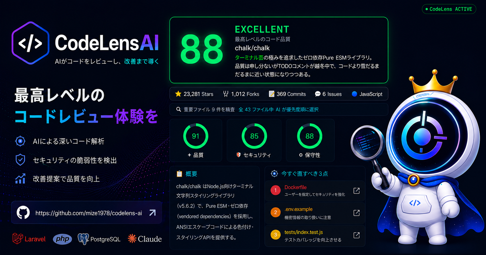
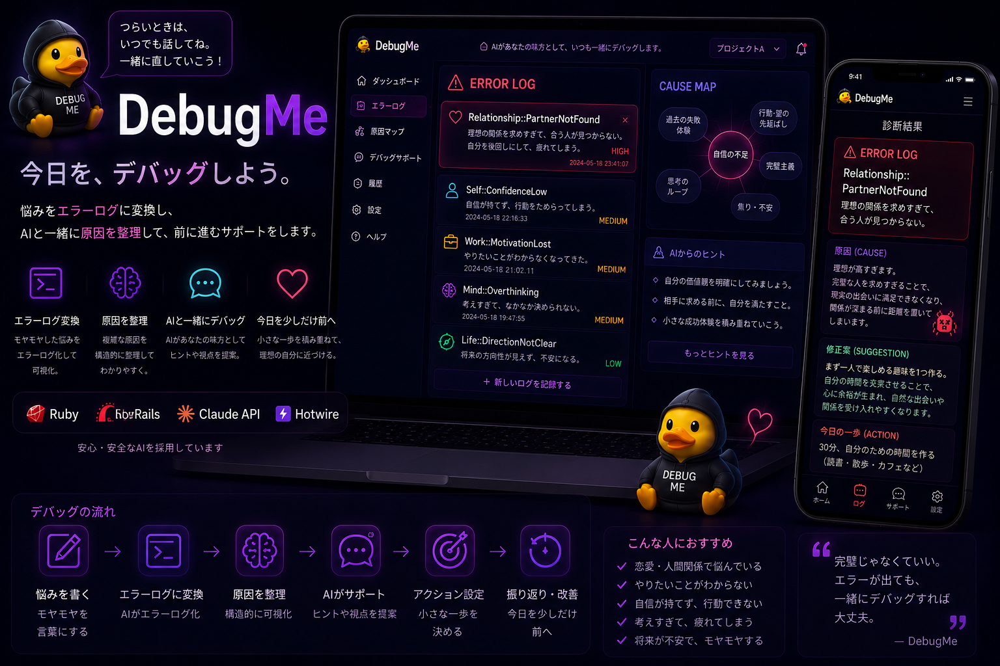
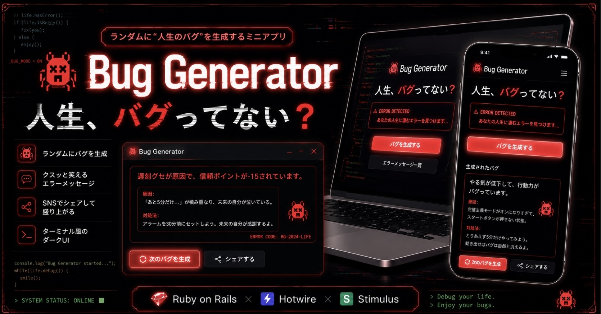
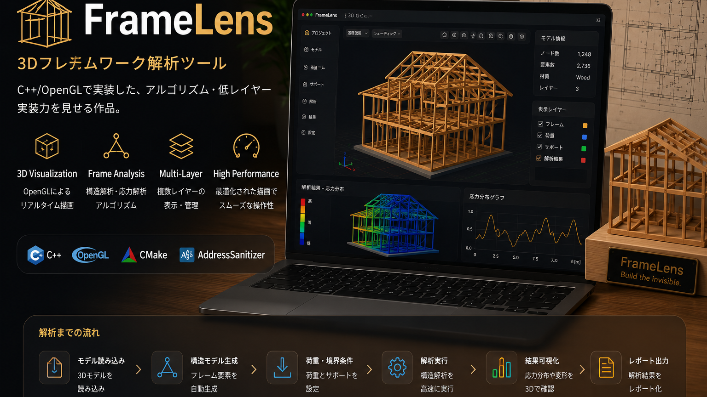
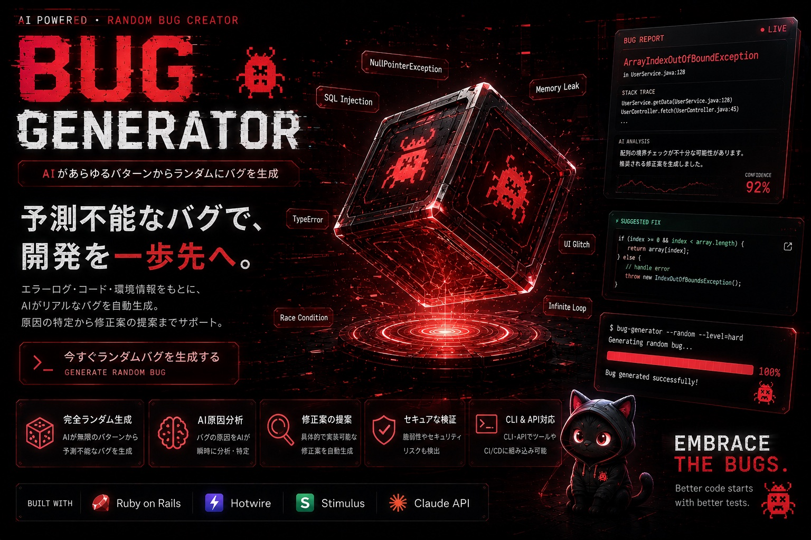

# MIZE

### 考えを、使えるかたちへ。

**Web development · AI · Visual storytelling**

株式会社 MizeLy 代表取締役。Webサイト制作・アプリケーション開発・映像制作に取り組んでいます。  
企画・UI/UX設計から実装まで、技術と表現を組み合わせて、触って楽しい体験をつくっています。

**[Portfolio ↗](https://mize1978.github.io/)** · [制作・開発](https://mize1978.github.io/#practice) · [技術記事](https://zenn.dev/mizel1978) · [X](https://x.com/mizelategm66172)

## いま取り組んでいること

<table>
<tr>
<td width="36%"></td>
<td><h3>🏢 AI OFFICE</h3><strong>AIエージェントの作業が見えるオフィス。</strong> CodexとClaude Codeの作業状況を、オフィスで働く姿として可視化する社内ツール。調査・編集・待機・失敗などの状態を、席とボードで把握します。  Next.js · React · TypeScript · PixiJS <strong>社内ツール・開発中</strong>  <a href="https://mize1978.github.io/#practice">紹介・動画を見る ↗</a> 掲載画像・紹介動画はテスト用データによる再現です。</td>
</tr>
<tr>
<td></td>
<td><h3>🦋 Butterfly Town</h3><strong>小さな一手が、街の未来を変える。</strong> 人格・記憶・目標を持つAI住民3人が暮らす、ミッション攻略型の街シミュレーションを制作中。会話と「蝶を放つ」介入で、街祭りの成功を目指します。  Ruby on Rails · React · TypeScript ／ ゲーム描画を検証中 <strong>RUNTEQ卒業制作・設計／技術検証中</strong>  <a href="https://github.com/mize1978/butterfly-town">企画・開発リポジトリ ↗</a> · <a href="https://mize1978.github.io/#practice">アート試作</a> 掲載画像はアート試作です。実LLMの統合・本体公開はこれから。</td>
</tr>
</table>

## つくっているもの

<table>
<tr>
<td width="36%"></td>
<td><h3>🎀 RewardMe</h3>毎日のタスクを、育てる楽しみに。 キャラクター育成やマイルーム、ミニゲームで習慣づくりを支えるアプリ。  Rails · Hotwire · PostgreSQL  <a href="https://rewardme-qaq3.onrender.com">使ってみる ↗</a> · <a href="https://github.com/mize1978/rewardme">コード</a> · <a href="https://zenn.dev/mizel1978/articles/a10a4368b282d3">開発記事</a></td>
</tr>
<tr>
<td></td>
<td><h3>🔍 CodeLensAI</h3>コードを読み、理解を積み重ねる。 Claude APIでコードの差分を解析し、改善提案につなげるレビュー支援アプリ。  Laravel · PHP · Claude API  <a href="https://codelens-ai-vplg.onrender.com">使ってみる ↗</a> · <a href="https://github.com/mize1978/codelens-ai">コード</a></td>
</tr>
<tr>
<td></td>
<td><h3>🐈‍⬛ DebugMe</h3>悩みを、エラーログに。 AIが原因や解決のヒントを、ターミナル風の画面で届けます。猫のNecoが案内役。  Rails · Claude API · SSE · Hotwire  <a href="https://debugme-2m5k.onrender.com">使ってみる ↗</a> · <a href="https://github.com/mize1978/debugme">コード</a></td>
</tr>
<tr>
<td></td>
<td><h3>🐞 Bug Generator</h3>人生、バグってない？ 仕事・恋愛・プログラミングなどのテーマから、架空のバグをランダム生成。笑える回避策も添えて。  Rails · Hotwire · Stimulus  <a href="https://bug.mizely.jp/">遊んでみる ↗</a> · <a href="https://github.com/mize1978/bug_generator">コード</a></td>
</tr>
<tr>
<td></td>
<td><h3>🏗️ FrameLens</h3>建物の骨組みを、コードから。 2×4フレームの手続き生成・3D可視化ツール。部材選択、寸法表示、拾い出しCSV出力を実装。  C++ · OpenGL · CMake  <a href="https://mize1978.github.io/framelens/">ブラウザで見る ↗</a> · <a href="https://github.com/mize1978/FrameLens">コード・実装内容</a> バナーの応力解析グラフは予定機能です。</td>
</tr>
</table>

## Web・デザイン・映像

コーポレートサイト、医院サイト、採用サイトのデザイン案、企業向けプレゼンテーション動画も制作しています。  
**[Web制作と映像の実例を見る ↗](https://mize1978.github.io/#web)**

## 開発について

- **Web / App** — Next.js · React · TypeScript · Astro · Ruby on Rails · Laravel · Hotwire
- **AI** — Claude API · OpenAI API ／ Codex・Claude Codeと連携した開発・作業の可視化
- **Graphics** — C++ · OpenGL · WebAssembly · WebGL2 · PixiJS · Phaser
- **Design / Creative** — UI/UX · Figma · STUDIO · 映像制作
- **Tools** — PostgreSQL · MySQL · Docker · GitHub Actions

利用技術と実装範囲、開発中・公開中の区別は、各作品の紹介をご覧ください。

ゲームUXとAI UXに関心があり、キャラクターや動きも含めて、触りたくなる体験を考えています。

🎨 Creator Workspace Exhibit — 作品の世界観を一枚に

  

各作品をイメージしたビジュアルです。実際の機能・画面は、それぞれのアプリとREADMEをご覧ください。

