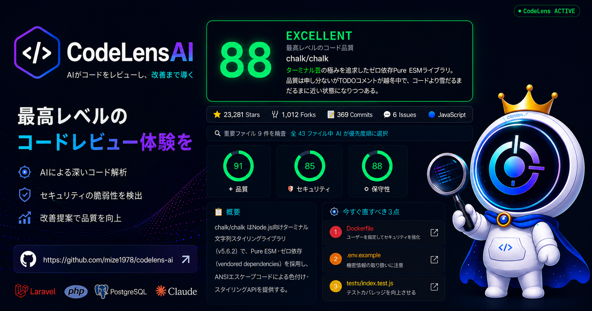
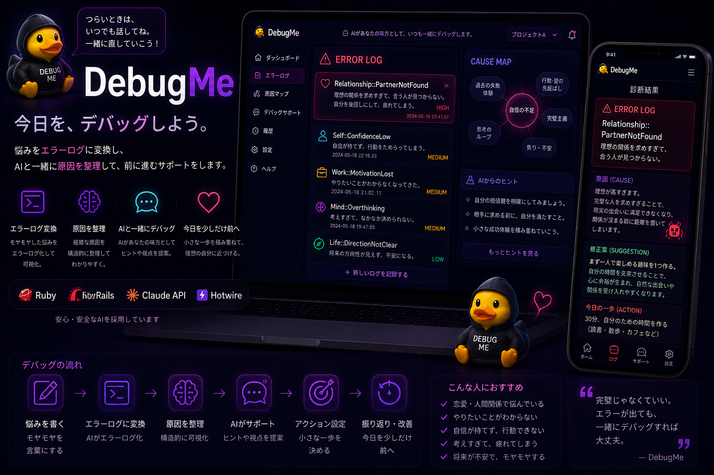
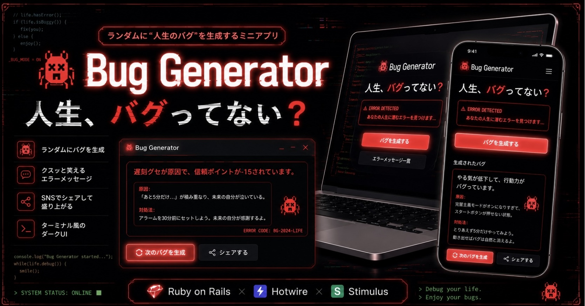
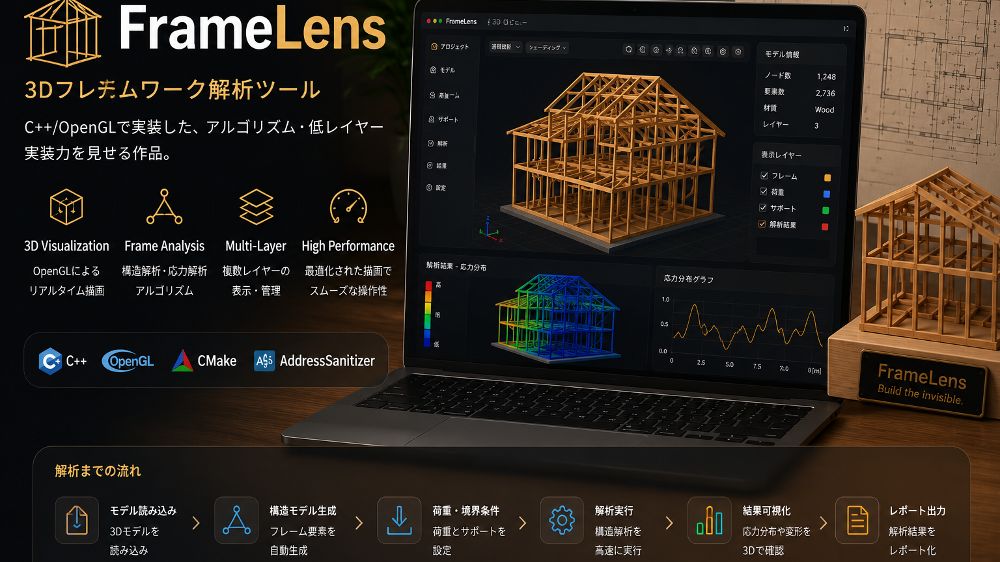

# MIZE

**Web・AI・C++で、使って楽しいソフトウェアをつくっています。**

Ruby on Railsを中心に、Laravel、Claude API、C++ / OpenGLまで。
企画・UI / UX設計・実装・デプロイを一貫して手がけています。

[作品を見る ↓](#つくっているもの) · [X](https://x.com/mizelategm66172)

## つくっているもの

<table>
<tr>
<td width="36%"></td>
<td><h3>🎀 RewardMe</h3>毎日のタスクを、育てる楽しみに。 キャラクター育成やマイルーム、ミニゲームで習慣づくりを支えるアプリ。  Rails · Hotwire · PostgreSQL  <a href="https://rewardme-qaq3.onrender.com">使ってみる ↗</a> · <a href="https://github.com/mize1978/rewardme">コード</a> · <a href="https://zenn.dev/mizel1978/articles/a10a4368b282d3">開発記事</a></td>
</tr>
<tr>
<td></td>
<td><h3>🔍 CodeLensAI</h3>コードを読み、理解を積み重ねる。 GitHubリポジトリをAIが分析し、レビューとその記録を残すアプリ。  Laravel · PHP · Claude API  <a href="https://codelens-ai-vplg.onrender.com">使ってみる ↗</a> · <a href="https://github.com/mize1978/codelens-ai">コード</a></td>
</tr>
<tr>
<td></td>
<td><h3>🐈‍⬛ DebugMe</h3>悩みを、エラーログに。 AIが原因や解決のヒントを、ターミナル風の画面で届けます。猫のNecoが案内役。  Rails · Claude API · SSE · Hotwire  <a href="https://debugme-2m5k.onrender.com">使ってみる ↗</a> · <a href="https://github.com/mize1978/debugme">コード</a></td>
</tr>
<tr>
<td></td>
<td><h3>🐞 Bug Generator</h3>人生、バグってない？ 仕事・恋愛・プログラミングなどのテーマから、架空のバグをランダム生成。笑える回避策も添えて。  Rails · Hotwire · Stimulus  <a href="https://bug-generator.onrender.com">遊んでみる ↗</a> · <a href="https://github.com/mize1978/bug_generator">コード</a></td>
</tr>
<tr>
<td></td>
<td><h3>🏗️ FrameLens</h3>建物の骨組みを、コードから。 2×4フレームの手続き生成・3D可視化ツール。部材選択、寸法表示、拾い出しCSV出力を実装。  C++ · OpenGL · CMake  <a href="https://github.com/mize1978/FrameLens">コード・実装内容 ↗</a> バナーの応力解析グラフは予定機能です。</td>
</tr>
</table>

## 開発について

- **Web** — Ruby / Rails、PHP / Laravel、JavaScript / Hotwire
- **AI** — Claude APIを使った分析・生成、結果を待つ時間も含めたUI設計
- **Native** — C++ / OpenGLでの3D可視化
- **Tools** — PostgreSQL、MySQL、Docker、GitHub Actions

RUNTEQ 79期。ゲームUXとAI UXに関心があり、キャラクターや動きも含めて、触りたくなる体験を考えています。

🎨 Creator Workspace Exhibit — 作品の世界観を一枚に

  

各作品をイメージしたビジュアルです。実際の機能・画面は、それぞれのアプリとREADMEをご覧ください。

